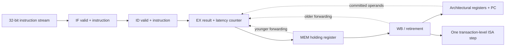

# RV32 pipelined CPU case study

This directory demonstrates natural-language specification issues → LeanSpec diagnosis → explicit decisions and revision → transaction ISA / cycle CPU → unbounded refinement → fault injection and correction → actual Yosys/ABC PDR runs.

The core supports **29 RV32I/M arithmetic instructions, 32×32-bit registers, a five-stage elastic pipeline, five independent stall inputs, forwarding, writeback backpressure, and multi-cycle multiplication/division**. MUL-family instructions occupy EX for at least three cycles; DIV/REM-family instructions for at least 34. There is no instruction/data memory, branch, jump, CSR, or exception handling. This is an RV32 arithmetic subset, not a complete RV32IM CPU. Instruction semantics were checked against [RV32I](https://docs.riscv.org/reference/isa/v20260120/unpriv/rv32.html) and the [M extension](https://docs.riscv.org/reference/isa/v20260120/unpriv/m-st-ext.html).

See [RESULTS.txt](RESULTS.txt) for the original demo/PDR summary, [BRIDGE_RESULTS.txt](BRIDGE_RESULTS.txt) for the two-level proof summary, and `evidence/bridge-latest.json` for complete proof evidence.



## Quick reproduction

Run from the repository root. Requirements: installed Lean 4.29.0, Python 3, Icarus Verilog, Yosys, and `yosys-abc`. No SMT solver, network access, or extra Python packages are needed.

```bash
# Needed only if the repository's LeanSpec library has not been built
lake build LeanSpec

# Diagnosis, all Lean proofs, three-way cycle checks, six fault/repair pairs, three PDR tasks
python3 case_cpu/scripts/demo.py

# Check source hashes/evidence from the latest complete run and regenerate summaries
python3 case_cpu/scripts/report.py

# Faster replay without PDR; still runs all Lean proofs and 24 random-program batches
python3 case_cpu/scripts/demo.py --skip-pdr

# Full miter: 60 seconds for PDR, with a separate 300-second synthesis limit
python3 case_cpu/scripts/pdr.py --task full --seconds 60 --synthesis-seconds 300

# Order/capacity properties only
python3 case_cpu/scripts/pdr.py --task order --seconds 60
```

`evidence/latest.json` points to the latest demo's actual results, including source SHA-256 hashes, proof logs, axiom audits, coverage, and mutation results. Each demo uses a new timestamped directory; interrupted failures are recorded as `failed`. Independent PDR runs record synthesis and engine results separately in `result.json`. Full-PDR timeouts are never reported as proofs. A demo status of `passed` means certificates, regressions, and correction checks completed; read each PDR task's `status` for its conclusion.

## Specification diagnosis and revision

The draft is [spec/original.txt](spec/original.txt); the frozen revision is [spec/revised.txt](spec/revised.txt). [spec/decisions.json](spec/decisions.json) maps issues, witnesses, answers, original clauses, and revised clauses.

| Type | Draft issue | Distinguishing / failing witness | Revision |
|---|---|---|---|
| ambiguity | Does EX stall freeze locally or globally? | EX stalled while WB can retire: 0 / 1 retirement | Each stall controls its own source action |
| ambiguity | Which of multiple writers supplies forwarding? | WB writes 7; younger MEM writes 9 | Younger writer wins |
| ambiguity | Does a three-cycle latency start at EX entry? | Latency parameter 3 / 4 | Set `remaining=L-1` on entry |
| incompleteness | Division-by-zero result unspecified | DIV permits multiple results | DIV returns all ones; REM returns the dividend |
| incompleteness | x0 write/reset behavior unspecified | Value after an x0 write is unconstrained | Read zero, discard writes, reset to zero |
| contradiction | Reset forbids retirement, but the WB clause includes reset edges | Same cycle requires retired=0 and retired=1 | Reset has priority |
| contradiction | Permanent stalls allowed, but retirement guaranteed within 40 cycles | WB blocked for 41 cycles | Remove unconditional completion bound |

[lean/Diagnosis.lean](lean/Diagnosis.lean) **actually invokes the repository's LeanSpec queries** and builds witness certificates with `decide +kernel`. It resolves contradictions before comparing surviving ambiguity candidates, avoiding misclassification of unsatisfiable readings as ambiguity. All seven final projected contexts admit exactly one observation.

Diagnosis here checks **seven clause contexts × seven projected observations**, not the complete CPU state space. x0 and division-by-zero scenarios deliberately model omissions in a draft, although the full RISC-V standard already specifies their behavior. Decisions are predetermined by the case author: this is a synthetic clarification demo, not answers from a user, independent designer, or hidden oracle. No new LLM diagnosis/revision experiment or automatic NL-to-Lean equivalence proof was run. Contradiction repair broadens previously dead contexts; it is not monotonic narrowing of the inconsistent draft.

## Two model levels and refinement conclusions

[lean/ISA.lean](lean/ISA.lean) defines instructions, strict binary decode, 32-bit arithmetic, register/PC state, and atomic `isaStep`. It does not import the pipeline. Division by zero, signed overflow, and x0 have separate Lean properties.

[lean/Pipeline.lean](lean/Pipeline.lean) defines five-stage state and `cycle`. Each cycle computes temporary next state in WB→MEM→EX→ID→IF order, allowing simultaneous departure/refill while each instruction crosses at most one boundary. ID dispatch applies pending WB retirement and then younger MEM effects to the committed state, obtaining EX's registers and PC. EX stores the result/countdown and waits for downstream capacity.

Execution units have fixed latency: the result is computed at EX entry, and a counter delays departure. There is no iterative divider. EX stall freezes countdown/departure; WB stall freezes retirement. An empty EX may accept ID while its own departure is stalled. ID entry and departure are similarly separate. Revised clauses specify priorities and earliest departure `t+L`, avoiding an ambiguous blanket rule to “hold when stalled.”

The inductive invariant in [lean/Refinement.lean](lean/Refinement.lean) requires each WB/MEM/EX packet's saved result to equal the ISA result after applying all older packets in order.

| Theorem | Scope |
|---|---|
| `cycle_inv` | Invariant preservation under arbitrary inputs, stalls, and resets |
| `cycle_refines` | Non-reset cycles stutter or execute exactly one ISA step; reset loads a new initial state |
| `full_refinement` / `reset_refinement` | Arbitrary finite input traces, including intermediate resets |
| `trace_conservation` | Within a reset-free epoch, `retired ++ pending = accepted`, preserving identity/order |
| `trace_isa` | Complete architectural state equals transaction ISA execution of the actual retirement sequence |
| `drained_refinement` | After drain, architecture equals ISA execution of **all accepted instructions** |

The final theorem combines functional correctness and instruction conservation, avoiding a claim that selects only retirement events while hiding lost instructions. All input words and register seeds are symbolic. There is no cycle bound or stall-fairness assumption. Permanent stalls require safety, not eventual retirement. Reset may explicitly abort in-flight instructions; conservation applies within reset epochs.

**The lower-level bridge is complete.** [bridge/SourceRefinement.lean](bridge/SourceRefinement.lean) proves one-cycle correspondence directly for `V2LeanImported.core.step`, imported from `rtl/cpu.sv`, then composes it with ISA refinement. RTL/cycle one-step equivalence is not assumed. The original RTL, ISA, and Pipeline sources remain frozen.

| Bridge theorem | Conclusion |
|---|---|
| `rtl_step_refines` | All 19 imported state-register groups correspond to `rawCycle` for one step, under arbitrary internal undefined-value choices |
| `rtl_cycle_refinement` | After the initial synchronous reset, arbitrary-length RTL traces map to frozen cycle LeanSpec, allowing repeated reset |
| `rtl_isa_refinement` | Composition of both levels equates RTL architecture with the transaction ISA reference |
| `rtl_isa_physical_events` | ISA reference reads actual RTL `retire_valid` / `retire_insn` outputs |
| `rtl_conservation` | In reset-free epochs, physical retirement plus pending instructions equals physical ready/valid acceptance |
| `rtl_drained_refinement` | After drain, architecture equals ISA execution of all physically accepted instructions |
| `retirement_pc` / `retirement_value` | Retirement PC/result agree with architecture and ISA effects; packet PC invariants are preserved from reset |
| `port_debug` / `port_arch_pc` | Physical debug and architectural-PC outputs match the architectural projection |

The lower-level decomposition is documented in [bridge/README.txt](bridge/README.txt). It checks the independent RTL decoder, all 29 ALU operations, 1024-bit RF access, forwarding, countdown, and elastic control. Shallow functions in `Circuit.lean` are generated from the actual LeanRTL AST; `Shallow.lean` proves node-by-node agreement with the deep evaluator. They are not a substitute implementation that bypasses the RTL.

**Trust boundary:** SystemVerilog→Yosys RTLIL→symbolic importer is a frontend trust boundary. Replay reimports the RTL and requires byte-identical imported data; it does not prove the SystemVerilog frontend correct inside Lean. The lower bridge uses native LRAT checking for `bv_decide` and `native_decide` for topology checks and exhaustive decoder tables. Full axiom rosters are retained and `sorryAx` is rejected. Therefore the extended chain is not a native-axiom-free kernel-only proof. The original upper-level proofs still use only their original standard axioms. Replay time excludes development, invariant discovery, and frontend correctness work.

```bash
# Reimport frozen RTL, check import agreement, replay both proof levels and the final axiom audit
python3 case_cpu/scripts/bridge.py
```

Independent records are in `evidence/bridge-latest.json`. The original `evidence/latest.json` retains earlier simulation/PDR measurements. The old full ABC PDR result remains a timeout; the new Lean proof does not turn it into a PDR proof.

## RTL, tests, and correction

[rtl/cpu.sv](rtl/cpu.sv) is actual compilable RTL. Its register file is a 1024-bit register vector, not RAM. It contains independent decoder, ALU, and temporary next-state logic.

[scripts/model.py](scripts/model.py) provides independent Python ISA arithmetic; [lean/Trace.lean](lean/Trace.lean) produces cycle outputs from the actual Lean model. [scripts/demo.py](scripts/demo.py) generates directed/random programs with fixed seeds and compares **Python / Lean / Icarus RTL on every cycle**: acceptance, retirement, instruction word, PC, result, destination, debug values, and occupancy. An independent retirement scoreboard checks order and ISA results; all 32 registers are observed after each drain.

Coverage includes all 29 instructions, all 32 stall masks, RAW/WAW forwarding, x0 writes, negative arithmetic shifts, three high-product variants, division by zero/signed overflow, long WB backpressure, execute-countdown stalls, invalid encodings, and reset with a nonempty pipeline.

Six RTL mutations remove forwarding, let older writers override younger ones, return zero for DIV by zero, ignore WB stall, replace ADD with SUB, or replace SRA with logical shift. Each mutation directory stores faulty RTL, the reproducible first-divergence input prefix, a repair patch, repaired RTL, and logs/traces for both sides. Repairs use explicit local text rules; the repaired source SHA-256 must equal the frozen correct RTL before full regression. **This is not an independent or blind LLM repair experiment.**

Separate direct-RTL ABC PDR correction evidence includes a [WB-stall counterexample](evidence/pdr-stall-mutant/result.json) and the [repaired property proof](evidence/pdr-stall-repaired/result.json). Counterexamples, faulty/repaired RTL hashes, and the same miter are retained. Replay any mutation independently, for example:

```bash
# Set RUN to the absolute evidence directory named in evidence/latest.json
python3 case_cpu/scripts/pdr.py --task sanity --rtl "$RUN/ignore_writeback_stall/faulty.sv" --out case_cpu/evidence/recheck-faulty
python3 case_cpu/scripts/pdr.py --task sanity --rtl "$RUN/ignore_writeback_stall/repaired.sv" --out case_cpu/evidence/recheck-repaired
```

[lean/Mutants.lean](lean/Mutants.lean) also provides three kernel-checked counterexamples on actual traces: missing forwarding, wrong division-by-zero behavior, and ignored WB stall. The repaired model's `corrected_refinement` restores unbounded Lean refinement. Finite simulation counterexamples are not described as unbounded RTL proofs.

## Yosys / ABC PDR baseline

[rtl/miter.sv](rtl/miter.sv) and [rtl/isa_reference.svh](rtl/isa_reference.svh) provide an independent RTL reference. It executes retiring instructions on its own RF/PC and does not call the DUT ALU or decoder. Instruction words, valid, all stalls, reset, the 1024-bit initialization vector, and debug addresses are unconstrained. The only environment assumption is reset on the first cycle; later resets are allowed. No fairness, fixed instruction stream, prescribed retirement result, or auxiliary inductive invariant is assumed.

| Task | Safety properties checked |
|---|---|
| `sanity` | Interface smoke checks: no retirement under WB stall, no ready under fetch stall, x0 debug reads zero |
| `order` | Accepted queue capacity at most 5; retirement requires a nonempty queue and its head instruction |
| `architecture` | Correct retirement operation/instruction PC; architectural PC and arbitrary debug register agree with the independent ISA |
| `full` | Conjunction of all properties above |

`order` alone does not prove eventual retirement or a no-loss liveness result. Passing the small `sanity` task is not architectural refinement.

The flow is `read_verilog -formal` → synchronous formal lowering → gate/AIG mapping → `write_aiger -zinit` → `yosys-abc`. ABC runs `fold` to preserve the reset assumption, explicitly combines **all bad outputs** with `orpos`, then runs `pdr -v -T N`. This is ABC property-directed reachability / IC3, not SMT-BMC. Original `.ys`, `.abc`, AIGER, map, tool versions, hashes, full logs, and status are retained.

Results distinguish `proved`, `counterexample`, `pdr_timeout`, `synthesis_timeout`, and tool errors. Synthesis and PDR have independent time limits. A PDR timeout is reported only after entering the engine. Earlier frontend experiments/failures under `evidence/` are development records, not final comparison results.

Long latency/backpressure combinations, two-writer forwarding, and nonlinear 32-bit arithmetic make this a more complex case. A single resource-limited run does not establish inherent PDR difficulty, attribute difficulty to stalls, or support a fair Lean/PDR speedup claim. No no-stall/no-multiply-divide ablation or equal auxiliary-lemma-budget experiment was performed.

## Relation to the original three-stage example

- The `in` in `stall1in` is merely an input-name suffix, with no special Verilog meaning. This case explicitly separates five source stalls.
- The original `reg_init` initializes `reg_v` on reset to preserve an arbitrary symbolic reference value; it does not initialize stage registers. Here `reg_init` explicitly supplies the actual RF's reset seed.
- `ready` expresses capacity/acceptance conditions; `valid` indicates an instruction; `go = incoming_valid && ready`. The original `stage2_go` already uses `wen_stage1` as incoming valid, so a synonymous `stage2_valid` is unnecessary.
- Sequential `<=` is nonblocking: right-hand sides read pre-edge values, then updates occur together. Combinational next-state `=` updates temporaries in order. Replacing all sequential `<=` with `=` changes semantics and can create races.
- `wire` declares a net; `assign` continuously drives a net. Their roles differ.
- Tags resemble ghost tokens tracking a selected transaction. The original `assume(tag2 → reg_v=stage3)` is a cutpoint assumption. Here initialization and cycle preservation establish the core relation; retirement correctness is not assumed directly.

## Native-memory extension

The roughly 1k-line, 38-instruction, 1 KiB native-RAM five-stage pipeline is documented in [memory/README.md](memory/README.md). It independently closes actual imported RTL/native RAM→cycle LeanSpec→transaction ISA, connects physical input/retirement events, and proves execution of the actual accepted program after drain. A trap-RD interface bug found during proving was repaired. Independent replay, axiom audits, simulation, and ABC PDR records are under `memory/evidence/`.
